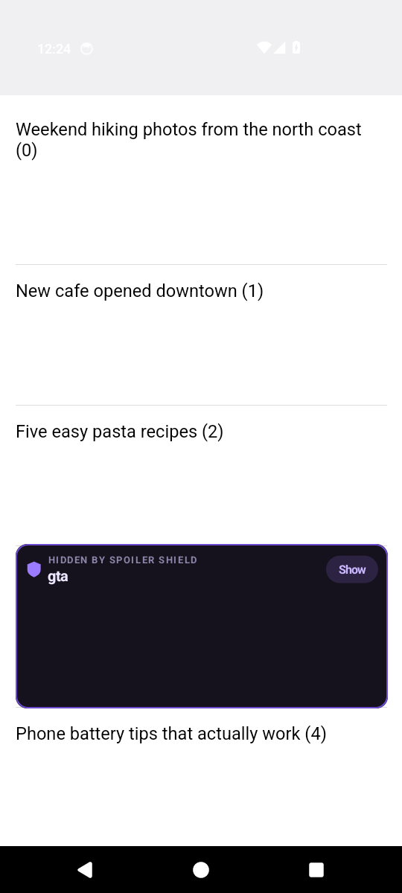
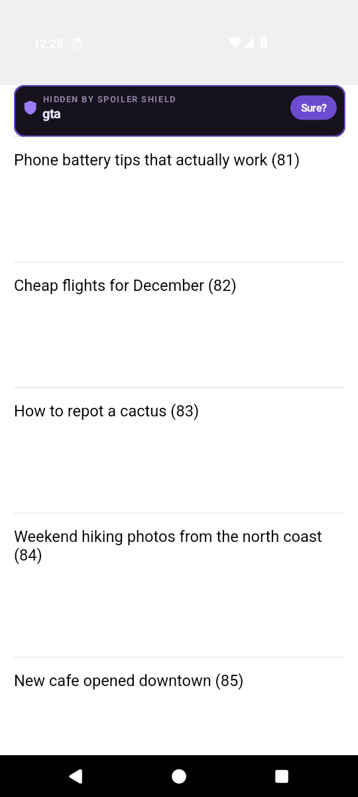
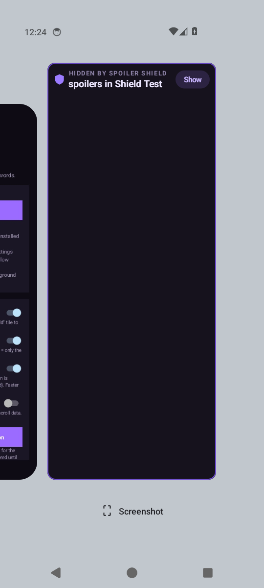

# 🛡️ Spoiler Shield

**An Android app that covers spoilers on your screen: in any app, as you scroll.**

Built to get through the months between GTA 6 on consoles and GTA 6 on PC without having it
spoiled. It reads the text on screen, and whenever something matches your keywords it puts a
cover over it that moves with the page.

<p align="center">
  
  &nbsp;
  
  &nbsp;
  
</p>

## What it does

- **Works everywhere.** YouTube, Telegram, Reddit, the browser, notifications: anything that
  shows text, with one app and no per-app setup.
- **Covers follow the scroll.** It watches for your finger and re-reads where the covered text
  is every frame, so covers move with the page instead of trailing behind it.
- **Tells you what it hid.** Each cover shows the word that triggered it (`gta`, a name, a
  place), so you can tell a real spoiler from a false alarm.
- **Show, if you want.** Tap **Show**, then **Sure?**, to uncover one item. Two taps, so a
  tap meant for the app underneath never uncovers anything by accident.
- **Recents too.** The app switcher shows pictures of your apps; if an app had spoilers on
  screen when you left it, its whole card is covered.
- **Your keywords.** A GTA list is built in; edit it to cover anything (English and Russian
  both work). Ignore apps you trust, pause it from a Quick Settings tile.

It reads text only: words inside images and videos can't be seen.

## Install

1. On your phone, download
   **[SpoilerShield.apk](https://github.com/mwkov/Gta/releases/latest/download/SpoilerShield.apk)**
   and open it. Android will ask to allow installing from your browser or files app.
2. Open Spoiler Shield and tap **Open Accessibility settings** → Spoiler Shield → turn it on.
   If Android says the setting is restricted: Settings → Apps → Spoiler Shield → ⋮ →
   *Allow restricted settings*, then try again.

**Updates:** when a new version is out, an *Update now* card appears at the top of the app.
One tap downloads it and Android asks to confirm. Settings and permissions stay.

## Privacy

- Screen text is read and checked **on the phone**. Nothing you see is saved or sent anywhere.
- The only network request is the update check: it fetches the version number from this
  repository's releases.
- The accessibility permission is needed to read the screen; the app uses it only to find
  matches and place covers.

## How it works

| Part | What it does |
| --- | --- |
| `ShieldService` | Accessibility service. Reads every window in parallel (one slow app can't hold up the rest), finds matches, keeps covers placed and moving. |
| `TrackMath` | Follows each scrolling list: scroll events and per-frame re-reads give its position; a short prediction covers the gap between readings. |
| `OverlayView` | Draws the covers on a click-through layer above everything. |
| `Updater` | Fetches the latest release into Android's installer. |

### Tested on an emulator on every change

`.github/workflows/emulator.yml` boots an Android emulator, runs a test app with a feed and a
web page full of matching lines, and drives real swipes and flings. The test app logs exactly
where each matching line is drawn, every frame, and the shield logs where its covers are. The
summary measures how often text was visible, for how long and how far off the covers were.
It also taps **Show** and opens Recents. Results land on the
[`test-results`](https://github.com/mwkov/Gta/tree/test-results) branch.

## Build

Every push to `main` runs the unit tests and builds a signed APK
(`.github/workflows/build.yml`). A new version number publishes a release.

```
gradle :app:assembleRelease
```
